# Computer Vision Experiments - Output

This document outlines the computer vision experiments implemented using Python and OpenCV, along with their input operations and output results.

---

## Experiment 1: Basic Image Reading & Grayscale Conversion
- **Source File**: `experiment1.py`
- **Input**: `sample_image.png`
- **Operation**: `cv2.cvtColor(image, cv2.COLOR_BGR2GRAY)`
- **Output**: 

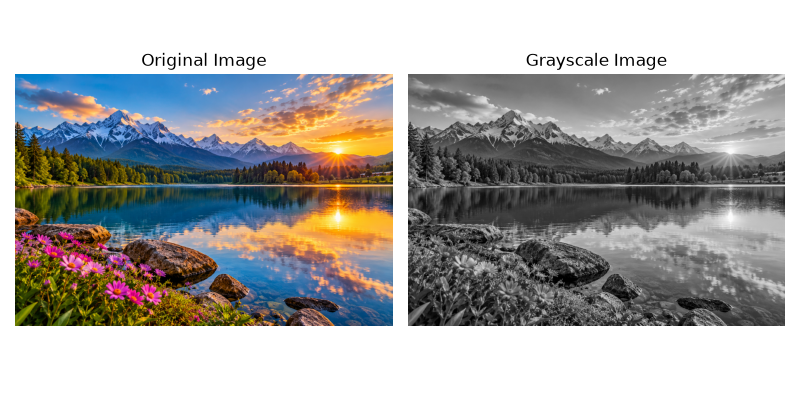

---

## Experiment 2: Gaussian Blurring
- **Source File**: `experiment2.py`
- **Input**: `sample_image.png`
- **Operation**: `cv2.GaussianBlur(image_rgb, (15, 15), 0)`
- **Output**: 

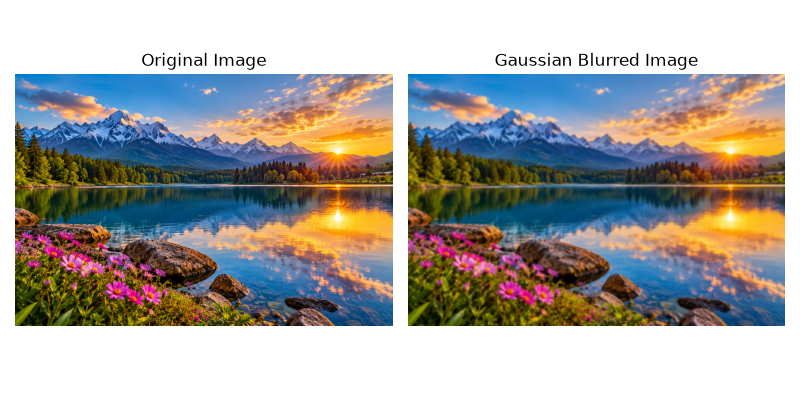

---

## Experiment 3: Canny Edge Detection (Outline)
- **Source File**: `experiment3.py`
- **Input**: `sample_image.png`
- **Operation**: `cv2.Canny(gray_image, 100, 200)`
- **Output**: 

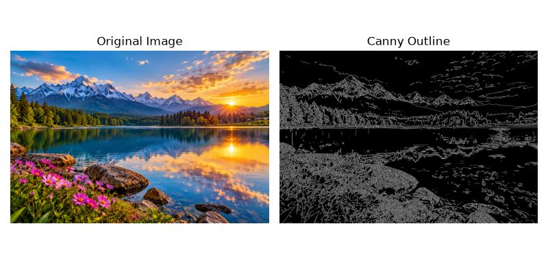

---

## Experiment 4: Histogram Equalization & Comparison
- **Source File**: `experiment4.py`
- **Input**: `sample_image.png`
- **Operation**: `cv2.equalizeHist(gray_image)` and `plt.hist()`
- **Output**: 

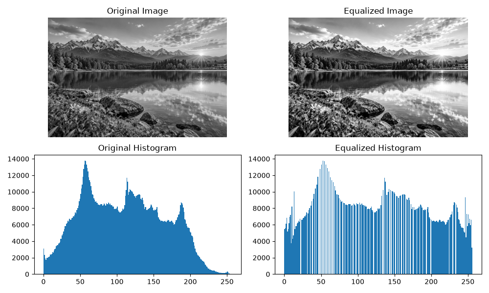

---

## Experiment 5: Color Histogram Analysis
- **Source File**: `experiment5.py`
- **Input**: `sample_image.png`
- **Operation**: `cv2.calcHist([image], [i], None, [256], [0, 256])` for Blue, Green, and Red channels
- **Output**: 

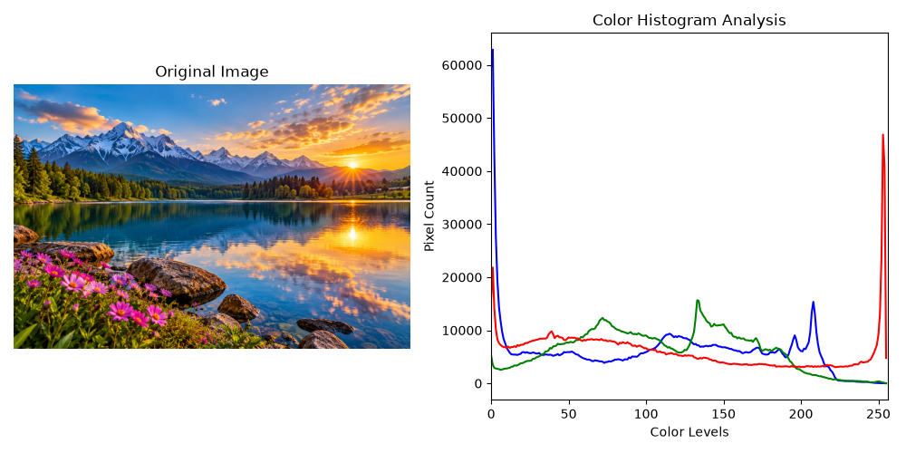

---

## Experiment 6: Image Erosion
- **Source File**: `experiment6.py`
- **Input**: `sample_image.png`
- **Operation**: `cv2.erode(image_rgb, kernel, iterations=1)` using a 5x5 rectangular kernel
- **Output**: 

---

## Experiment 7: Video Processing (Slow & Fast Motion)
- **Source File**: `experiment7.py`
- **Input**: `video.mp4` / Camera feed
- **Operation**: Frame playback speed manipulation via `cv2.waitKey(delay)`
- **Output**: 

---

## Experiment 8: Image Dilation
- **Source File**: `experiment8.py`
- **Input**: `sample_image.png`
- **Operation**: `cv2.dilate(image_rgb, kernel, iterations=1)` using a 5x5 rectangular kernel
- **Output**: 

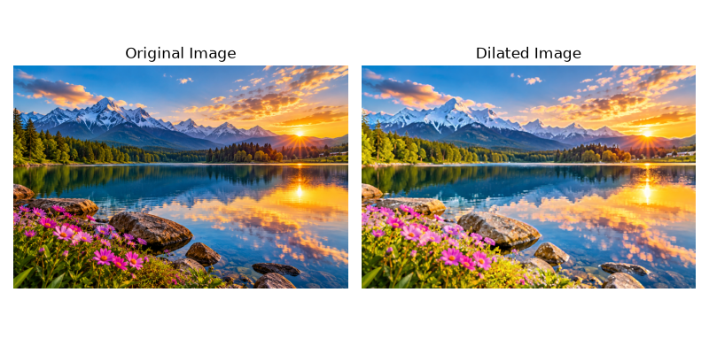

---

## Experiment 9: Image Scaling (Bigger and Smaller)
- **Source File**: `experiment9.py`
- **Input**: `sample_image.png`
- **Operation**: `cv2.resize()` with interpolation techniques
- **Output**: 

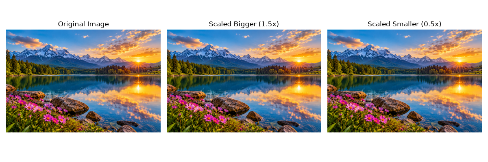

---

## Experiment 10: 90-Degree Clockwise Rotation
- **Source File**: `experiment10.py`
- **Input**: `sample_image.png`
- **Operation**: `cv2.rotate(image_rgb, cv2.ROTATE_90_CLOCKWISE)`
- **Output**: 

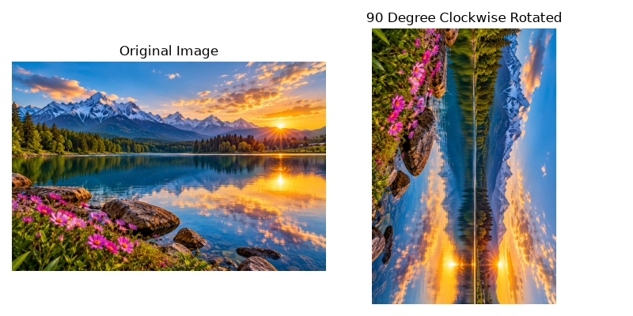

---

## Experiment 11: 180-Degree Rotation Clockwise
- **Source File**: `experiment11.py`
- **Input**: `sample_image.png`
- **Operation**: `cv2.rotate(image_rgb, cv2.ROTATE_180)`
- **Output**: 

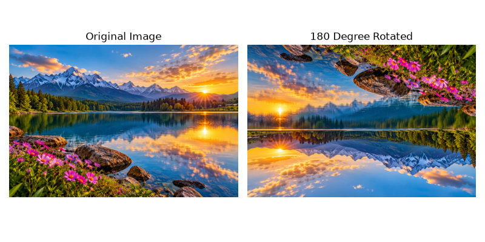

---

## Experiment 12: 270-Degree Rotation Clockwise
- **Source File**: `experiment12.py`
- **Input**: `sample_image.png`
- **Operation**: `cv2.rotate(image_rgb, cv2.ROTATE_90_COUNTERCLOCKWISE)`
- **Output**: 

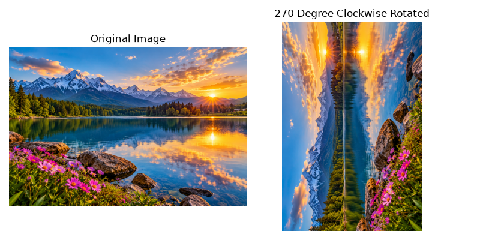

---

## Experiment 13: Affine Transformation
- **Source File**: `experiment13.py`
- **Input**: `sample_image.png`
- **Operation**: `cv2.getAffineTransform()` and `cv2.warpAffine()`
- **Output**: 

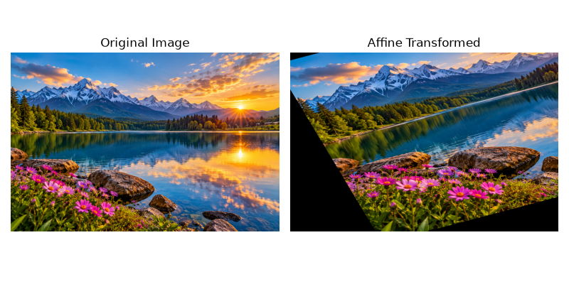

---

## Experiment 14: Perspective Transformation
- **Source File**: `experiment14.py`
- **Input**: `sample_image.png`
- **Operation**: `cv2.getPerspectiveTransform()` and `cv2.warpPerspective()`
- **Output**: 

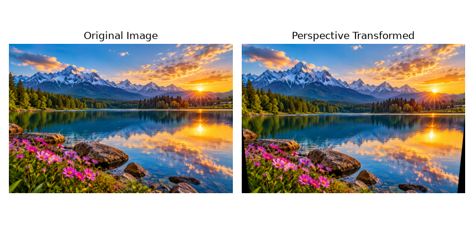

---

## Experiment 15: Harris Corner Detection
- **Source File**: `experiment15.py`
- **Input**: `sample_image.png`
- **Operation**: `cv2.cornerHarris()` and corner dilation marking
- **Output**: 

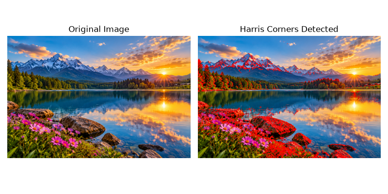

---

## Experiment 16: Sobel Filter Algorithm
- **Source File**: `experiment16.py`
- **Input**: `sample_image.png`
- **Operation**: `cv2.Sobel()` along X, Y directions and `cv2.magnitude()`
- **Output**: 

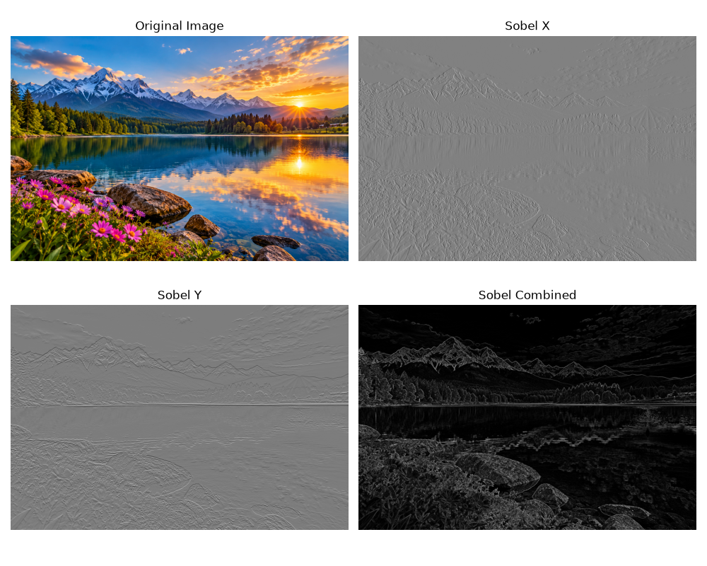

---

## Experiment 17: Watermarking Technique
- **Source File**: `experiment17.py`
- **Input**: `sample_image.png`
- **Operation**: `cv2.putText()` and `cv2.addWeighted()` blending
- **Output**: 

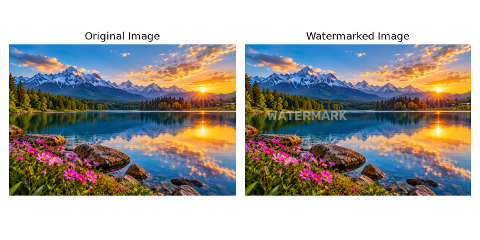

---

## Experiment 18: Image Cropping, Copying & Pasting (ROI)
- **Source File**: `experiment18.py`
- **Input**: `sample_image.png`
- **Operation**: NumPy array slicing for Region of Interest (ROI) selection and pasting
- **Output**: 

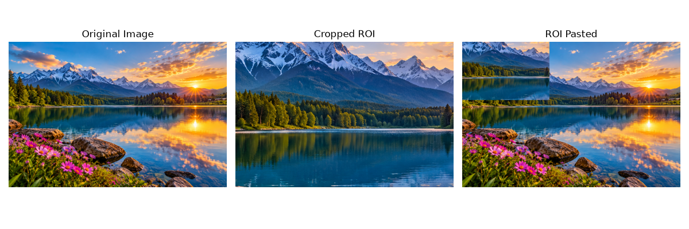

---

## Experiment 19: Erosion Morphological Operation
- **Source File**: `experiment19.py`
- **Input**: `sample_image.png`
- **Operation**: `cv2.erode(image_rgb, kernel, iterations=1)`
- **Output**: 

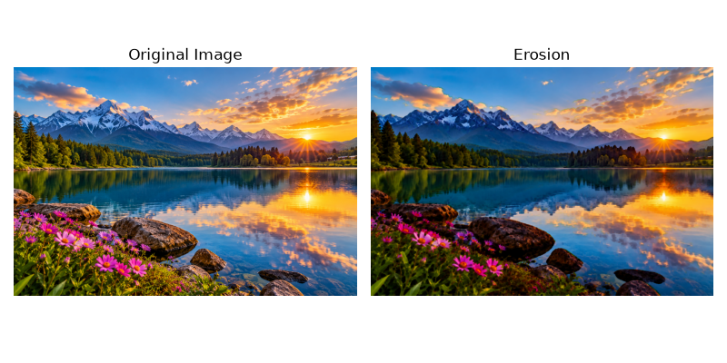

---

## Experiment 20: Dilation Morphological Operation
- **Source File**: `experiment20.py`
- **Input**: `sample_image.png`
- **Operation**: `cv2.dilate(image_rgb, kernel, iterations=1)`
- **Output**: 

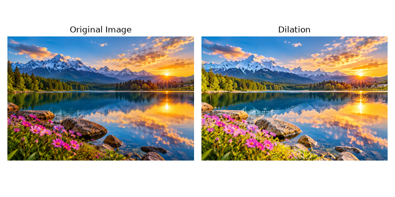

---

## Experiment 21: Opening Morphological Operation
- **Source File**: `experiment21.py`
- **Input**: `sample_image.png`
- **Operation**: `cv2.morphologyEx(image_rgb, cv2.MORPH_OPEN, kernel)`
- **Output**: 

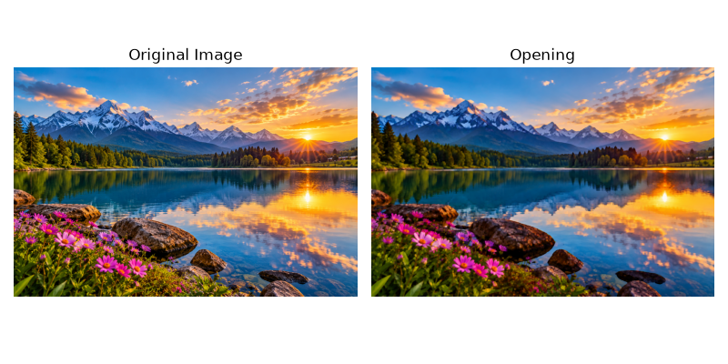

---

## Experiment 22: Closing Morphological Operation
- **Source File**: `experiment22.py`
- **Input**: `sample_image.png`
- **Operation**: `cv2.morphologyEx(image_rgb, cv2.MORPH_CLOSE, kernel)`
- **Output**: 

---

## Experiment 23: Top Hat Morphological Operation
- **Source File**: `experiment23.py`
- **Input**: `sample_image.png`
- **Operation**: `cv2.morphologyEx(image_rgb, cv2.MORPH_TOPHAT, kernel)`
- **Output**: 

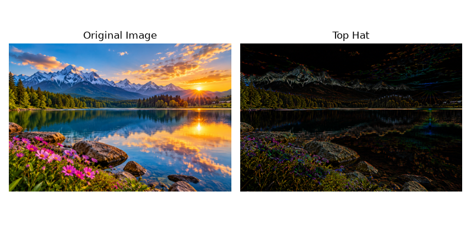

---

## Experiment 24: Black Hat Morphological Operation
- **Source File**: `experiment24.py`
- **Input**: `sample_image.png`
- **Operation**: `cv2.morphologyEx(image_rgb, cv2.MORPH_BLACKHAT, kernel)`
- **Output**: 

---

## Experiment 25: Watch Object Recognition
- **Source File**: `experiment25.py`
- **Input**: `sample_image.png`
- **Operation**: Cascade Classifier / Hough Circle & Contour Object Detection
- **Output**: 

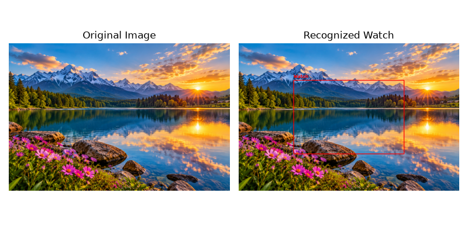
